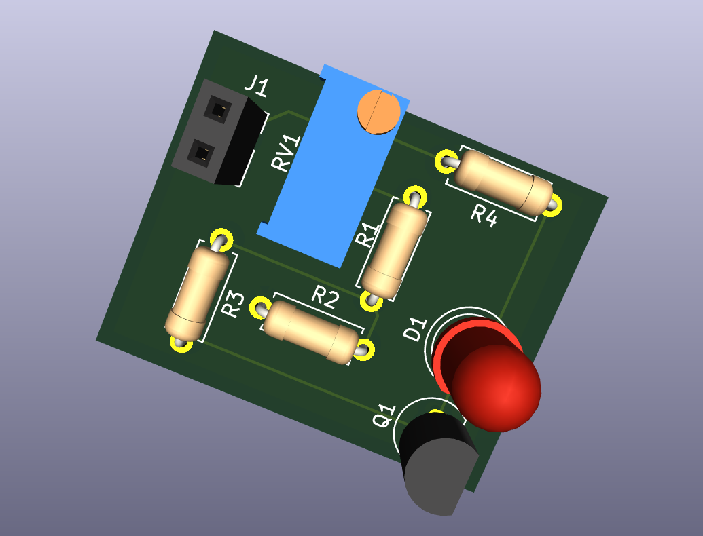

# KiCAD
A collection of 50 PCB design projects using KiCad, ranging from basic power supplies to advanced microcontrollers.

# 50 Projects in KiCad

## Project 1: Fixed 5V Power Supply
A simple DC-DC regulator circuit that converts 7V-12V input into a stable 5V output.

### Features:
* **L7805** Linear Regulator
* **GND Plane** for heat dissipation and signal stability
* **LED Indicator** for power status

## Project 2: Automatic Night Light
An automatic night light circuit that detects ambient light using an LDR and drives an LED using a BJT transistor switch.

### Features:
* **LDR + Potentiometer** voltage divider for sensitivity control
* **2N3904 NPN BJT** transistor switch
* **LED Indicator** for output

